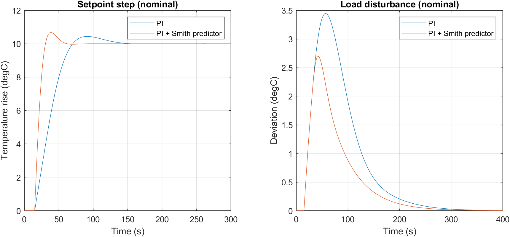
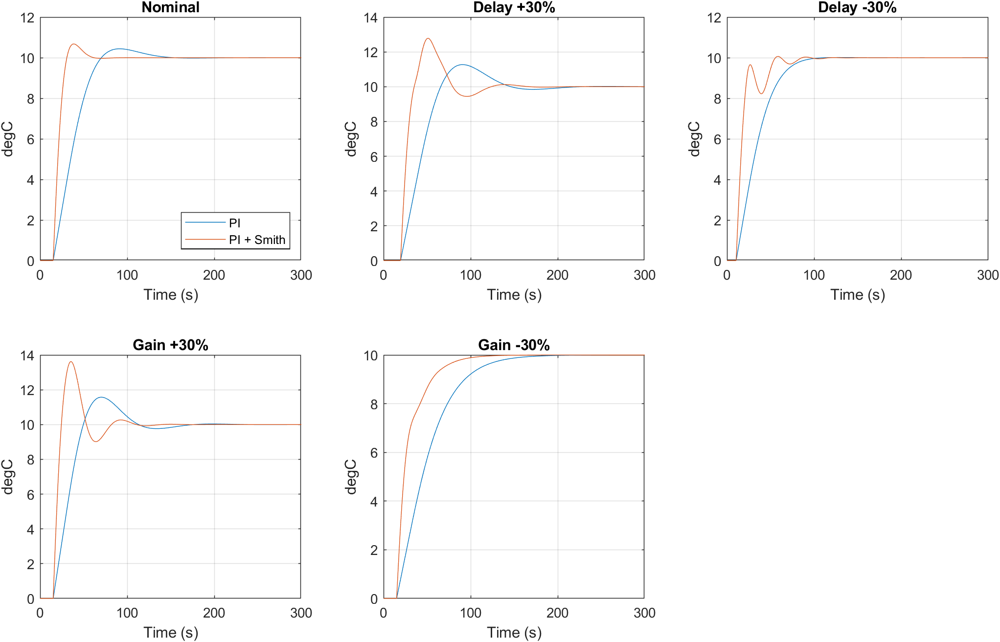

# Heat Exchanger Temperature Control with Transport Delay (MATLAB)

PI control versus PI control with a Smith predictor for a delay-dominant heat exchanger, with system identification, robustness, disturbance and noise analysis.

## Objective

Processes with a long transport delay are hard to control with a plain PI controller, because the delay forces a conservative tuning. This project tests whether a Smith predictor improves control of such a process, and where it breaks down.

## Plant

First-order-plus-dead-time (FOPDT) model: G(s) = K e^(-θs) / (τs + 1)

| Parameter | Value |
|---|---|
| Gain K | 1.5 °C per unit input |
| Time constant τ | 50 s |
| Delay θ | 15 s |
| Sensor (RTD) lag | 5 s |
| Measurement noise | 0.05 °C |

## Method

1. **System identification:** a noisy step test (1 s sampling) was generated and fitted with `procest` (type `P1D`). Identified K = 1.500, τ = 50.0 s, θ = 15.0 s, fit 98.94%.
2. **PI design:** Simple Internal Model Control (SIMC) tuning, with the sensor lag added to the delay (effective delay 20 s). Kc = 0.834, Ti = 50 s.
3. **PI + Smith predictor design:** an internal model with and without delay corrects the controller error. Kc = 3.336, Ti = 50 s.
4. **Evaluation:** 10 °C setpoint step and a 5% load disturbance at the plant input, for five cases: nominal, delay ±30%, gain ±30% (real plant differs from the model). Metrics: overshoot, settling time (5% band), IAE, disturbance peak, sensitivity peak Ms, and valve movement caused by noise.

## Results (final design)

| Case | Controller | Overshoot (%) | Settling (s) | IAE | Disturbance peak (°C) |
|---|---|---|---|---|---|
| Nominal | PI | 4.39 | 63 | 387.96 | 3.45 |
| | PI + Smith | 6.78 | 45.5 | 221.93 | 2.70 |
| Delay +30% | PI | 12.68 | 124 | 468.68 | 3.73 |
| | PI + Smith | 27.83 | 102.5 | 342.33 | 3.07 |
| Delay -30% | PI | 0.09 | 72 | 350.69 | 3.16 |
| | PI + Smith | 0.64 | 50.5 | 201.11 | 2.29 |
| Gain +30% | PI | 15.73 | 99.5 | 376.67 | 4.22 |
| | PI + Smith | 36.21 | 74.5 | 279.56 | 3.36 |
| Gain -30% | PI | 0 | 112.5 | 521.41 | 2.63 |
| | PI + Smith | 0 | 69.5 | 307.06 | 2.03 |

| Case | Ms (PI) | Ms (PI + Smith) |
|---|---|---|
| Nominal | 1.56 | 1.84 |
| Delay +30% | 1.76 | 2.20 |
| Delay -30% | 1.39 | 1.77 |
| Gain +30% | 1.81 | 2.44 |
| Gain -30% | 1.35 | 1.48 |

Valve movement caused by sensor noise (standard deviation): PI 0.040, PI + Smith 0.156 (about 3.9 times higher).

**Findings**
- Settling time was 17-38% shorter with the Smith predictor.
- Setpoint IAE was about 26-43% lower, and the load-disturbance peak about 18-28% lower.
- Overshoot was higher with the Smith predictor in every case that overshoots, and more than doubled for delay +30% and gain +30%.
- The sensitivity peak Ms was higher in every case, and above 2 for delay +30% and gain +30%.

## Figures

## Limitations

- Simulation only. The data come from a simulated plant with the same structure as the model, so the near-perfect identification is expected.
- The two controllers are not matched for equal robustness (the Smith design has a higher Ms), so part of its speed advantage comes from more aggressive tuning.
- No actuator saturation, anti-windup or time-varying delay was modelled.

## Files

| File | Purpose |
|---|---|
| `hx_model.m` | Plant model and open-loop step response |
| `hx_identify.m` | Step-test generation and system identification (saves `hx_est.mat`) |
| `hx_est.mat` | Identified model, loaded by the other scripts |
| `hx_pi.m`, `hx_smith.m` | First PI and Smith predictor designs |
| `hx_robust.m`, `hx_dist.m`, `hx_noise.m` | Robustness, disturbance and noise tests (first design) |
| `hx_final.m`, `results.csv` | First design: full comparison table |
| `hx_final2.m`, `results2.csv` | Final design (sensor lag modelled): full comparison table |
| `hx_check.m` | Sensitivity peak Ms and valve-noise check |
| `Heat_Exchanger_Smith_Predictor_Report.pdf` | Full project report |
| `fig_nominal.png`, `fig_robustness.png` | Figures shown above |

## How to run

1. Run `hx_identify.m` to identify the model. It saves `hx_est.mat` (a copy is included).
2. Run `hx_final2.m` for the final results table, and `hx_check.m` for the sensitivity peaks, valve noise and figures.
3. `hx_model.m` is stand-alone and shows the open-loop plant response.

## Requirements

MATLAB with Control System Toolbox and System Identification Toolbox.

## Author

Anjana Mahendran, M.Tech Instrumentation & Control Engineering, CUSAT
